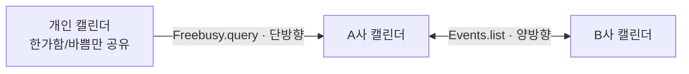

요즘 회사 두 곳에서 일하고 있습니다. 계정이 둘이니 캘린더는 두 개, 여기에 개인 캘린더까지 더하면 셋입니다. 저야 휴대폰과 브라우저에 3개의 프로필을 관리하면 되지만 문제는 저에게 인비를 보내는 분들입니다. 회사 간의 경계가 있고 사생활도 있다 보니 하나의 캘린더로 관리할 수도 없고.. A회사 동료가 회의를 잡을 때 제가 그 시간에 B회사 회의에 들어가 있는지 알 방법이 없습니다. 그래서 하루 시작 일과 중 하나가 "언제 시간이 되는지" 에 대답하는 일이었습니다.

> "두 번 이상 한 일은 자동화 해라." 

라는 모토 아래.. 자동화를 구상했고, Apps Script로 "바쁨" 정보만 주기적으로 서로 복제하면 되겠다 싶었습니다. 실제로 코드는 빈 줄까지 세도 130줄 남짓입니다. 다만 이 때문에 Google Admin 에서 몇 가지 수정이 필요하다보니 어떤 권한이 필요한지, 그리고 소스코드와 함께 정리했습니다.

## 캘린더를 공유하면?

제일 먼저 해본 건 캘린더 공유였습니다. B사 계정을 A사 계정에 공유하면 제 A사 캘린더 화면에는 B사 일정까지 겹쳐서 잘 보입니다. 일단 저는 이제 더 이상 중복으로 스케줄을 잡지 않을 수 있습니다만..

동료가 회의를 잡을 때 제 **기본 캘린더만** 보일 겁니다. 제가 A사 계정에서 B사 캘린더를 아무리 예쁘게 구독해 놔도 동료의 스케줄러는 그 캘린더를 보지 않습니다. 동료 입장에서 제 A사 캘린더는 여전히 텅 비어 있는 거죠.

그러니까 "보이게 하기"로는 부족하고, **기본 캘린더에 진짜 일정을 만들어 넣어야** 합니다. 제목을 `B Busy` 같은 무의미한 문자열로 두면 상대 내용은 비밀로 하고 시간만 막을 수 있고요.

## 사전 설정 — 캘린더 공유 권한

블록을 만들려면 스크립트가 상대 캘린더를 읽어야 합니다. 여기서 Google Admin 설정을 건드려야 할 수 있습니다.

개인 캘린더는 간단합니다. 개인 Google 캘린더 설정에서 [특정 사용자와 공유] 에 회사 주소를 넣고 **"한가함/바쁨 정보만 보기"** 로 두면 끝입니다.

회사 계정끼리는 다릅니다. 도메인이 서로 다르니 상대 회사에서 저는 외부 사용자입니다. 캘린더 설정에서 **"모든 일정 세부정보 보기"** 를 골라도 그대로 나가지 않습니다. **도메인 정책이 상한**이라, 상한이 "한가함/바쁨"에 걸려 있으면 사용자가 뭘 고르든 상대에겐 free/busy만 보입니다.

그래서 관리 콘솔에서 상한부터 올립니다.

> [관리 콘솔](https://admin.google.com/) → 앱 → Google Workspace → Calendar → 공유 설정 → **외부 공유 옵션(기본 캘린더)**

**"모든 정보를 공유하지만 외부 사용자는 캘린더를 변경할 수 없음"** 이면 충분합니다. 스크립트는 읽기만 하니 쓰기까지 열 이유가 없습니다. 설정이 반영되는 데 시간이 좀 걸리니, 바꾸자마자 안 되더라도 코드를 의심할 필요는 없습니다.

| 소스 | 사용자가 줄 공유 수준 | 관리 콘솔 |
| --- | --- | --- |
| A사 ↔ B사 | 모든 일정 세부정보 보기 | 양쪽 도메인에서 외부 공유 상한 올리기 |
| 개인 → 회사 | 한가함/바쁨 정보만 보기 | 필요 없음 |

여기서 공유 수준을 어떻게 고르느냐에 따라 뒤에서 쓸 코드 경로도 달라집니다.

## 미러 블록 만들기

구조는 단순합니다. 미러 블록을 **받을** 계정에서 스크립트를 돌립니다. 상대 캘린더를 읽고 내 기본 캘린더에 블록을 만드는 거죠. 받는 쪽에서 돌리면 상대 계정에 쓰기 권한을 줄 필요도 없습니다. 읽기 권한만 있으면 됩니다.



트리거는 15분마다 돌립니다. 매번 싹 지웠다 다시 만들지 않고 **diff** 로 처리했습니다. 원본에만 있는 구간은 만들고, 내 쪽에만 남은 구간은 지웁니다. 원본 일정을 옮기거나 지워도 한 주기 안에 따라오는 거죠.

제가 만든 블록은 `extendedProperties.private` 태그로 골라냅니다. 제목으로 구분하면 제목을 한 번 손대는 순간 고아가 되니까요.

```javascript
Calendar.Events.insert({
  summary: 'Personal Busy',
  start: {dateTime: parts[0]},
  end: {dateTime: parts[1]},
  reminders: {useDefault: false},
  extendedProperties: {private: {personalBusySync: '1'}}
}, 'primary');
```

`Events.list` 에 `privateExtendedProperty: 'personalBusySync=1'` 을 주면 제가 만든 블록만 돌아옵니다. 사용자가 직접 만든 일정은 건드리지 않습니다.

## 미러 블록을 비공개로 만들면 안 된다

회사 두 곳 사이는 양방향입니다. A→B 스크립트와 B→A 스크립트가 각각 돌기 때문에, A→B가 만든 블록을 B→A가 다시 A로 복사할 수 있습니다. 이런 무한 반사는 미러 블록 제목을 목록에 넣어두고 읽을 때 거르면 막힙니다.

```javascript
const MIRROR_SUMMARIES = ['A Busy', 'B Busy', 'Personal Busy'];
// ...
MIRROR_SUMMARIES.indexOf(e.summary) < 0
```

그런데 실제로 돌려보니 A 캘린더에 `A Busy` 가 34개나 되돌아왔습니다. 원인은 블록에 넣어둔 `visibility: 'private'` 이었습니다. **비공개 일정은 다른 계정에서 읽으면 제목이 가려집니다.** 상대 스크립트에 `summary` 는 `undefined` 로 들어오고, `undefined` 가 `MIRROR_SUMMARIES` 에 있을 리 없으니 필터를 통과한 거죠. 프라이버시를 지키려고 넣은 옵션이 에코 방지 장치를 꺼버린 셈입니다.

`visibility` 를 빼면 해결됩니다. 어차피 제목은 `A Busy` 뿐이라 숨길 것도 없습니다. diff 조건에는 `e.visibility !== 'private'` 을 추가했습니다. 예전에 잘못 만든 블록이 남아 있으면 재사용하지 않고 지운 뒤 다시 만듭니다.

다만 제목 목록으로 미러 블록을 거르는 방식은 오래 못 갔습니다.

## 공유 권한이 읽는 API를 정한다

개인 캘린더는 앞의 표대로 **"한가함/바쁨 정보만 보기"** 입니다. 이 상태에서 기존 코드를 돌리면 어떻게 될까요? 두 API를 나란히 호출해봤습니다.

```javascript
function probePersonal() {
  const CAL = 'me@personal.com';
  const timeMin = new Date().toISOString();
  const timeMax = new Date(Date.now() + 7 * 864e5).toISOString();

  const fb = Calendar.Freebusy.query({timeMin, timeMax, items: [{id: CAL}]}).calendars[CAL];
  Logger.log('FREEBUSY errors=' + JSON.stringify(fb.errors || null) + ' busy=' + (fb.busy || []).length);

  const r = Calendar.Events.list(CAL, {timeMin, timeMax, singleEvents: true, maxResults: 5});
  Logger.log('EVENTS.LIST count=' + (r.items || []).length + ' firstSummary=' + ((r.items || [])[0] || {}).summary);
}
```

```sh
FREEBUSY errors=null busy=10
EVENTS.LIST count=3 firstSummary=undefined
```

`Events.list` 호출은 성공했지만, 로그에 찍힌 첫 일정의 제목은 `undefined`였습니다. 같은 7일 구간에서 free/busy는 10개 구간, 이벤트 조회는 3개 항목을 반환했습니다. 다만 이 숫자만으로 일정이 누락됐다고 판단할 수는 없습니다. 위 코드는 `maxResults: 5`로 첫 페이지만 읽고, `nextPageToken`은 확인하지 않았기 때문입니다. [공식 문서](https://developers.google.com/workspace/calendar/api/v3/reference/events/list)에 따르면 요청한 개수보다 적게 돌아와도 다음 페이지가 있을 수 있습니다. 바쁜 시간 구간 수와 개별 일정 수도 같은 기준은 아닙니다.

이때 확인한 문제는 개수보다 제목이었습니다. 호출이 성공해도 **제목이 안 보이면 제목 목록으로 미러 블록을 거를 수 없습니다.** 바쁜 시간만 받아서는 원래 일정과 미러 블록도 구분할 수 없습니다. 그래서 이 동기화 방식에서는 한가함/바쁨만 공유한 캘린더를 되돌려받지 않는 단방향 소스로만 씁니다.

그래서 개인 캘린더는 `Freebusy.query` 로 읽습니다. 애초에 이 권한 수준에 맞춰진 API라 겹치는 구간도 합쳐서 줍니다. 개별 일정의 경계가 덜 드러나니 프라이버시에도 낫고요.

| 소스 공유 권한 | 읽는 API | 제목이 보이나 | 가능한 방향 |
| -------------------------- | ----------------- | ------- | -------- |
| 모든 일정 세부정보 보기 | `Events.list` | 보임 | 양방향 |
| 한가함/바쁨 정보만 보기 | `Freebusy.query` | 안 보임 | **단방향만** |

## 제목을 식별자로 쓰지 말 것

제목 목록은 한동안 잘 돌았습니다. 문제는 시간이 지나면서 드러났어요.

블록 제목을 한글에서 영문으로 한 번 바꿨더니, 목록에 옛 제목이 그대로 남았습니다. 지우려면 "그 이름으로 만든 블록이 아직 어딘가 남아 있나?"를 사람이 추적해야 합니다. 확인하기 전까지는 못 지우니 그냥 쌓입니다.

목록이 **두 스크립트에 각각** 있다는 것도 문제였습니다. 어느 쪽에 어떤 제목을 넣느냐에 따라 동작이 달라지는데, 그 차이가 코드 어디에도 안 적혀 있습니다. 저는 한쪽에서 `Personal Busy` 를 빼먹은 걸 한참 뒤에 알았습니다.

결정적으로, 사용자가 진짜 회의 제목을 "B Busy"로 지으면 그 회의가 **상대 캘린더에 복사되지 않습니다.** 원본 회의가 삭제되는 것은 아닙니다. 표시용 문자열을 식별자로 쓰면 언젠가는 부딪힙니다.

그래서 뭘로 거르는 게 맞을까 하다가, 미러 블록을 만들 때 이미 붙이고 있던 `extendedProperties.private` 태그가 눈에 들어왔습니다. 문제는 저게 이름 그대로 "private"이라 남이 읽을 수 있는지였습니다. 확인해보니 이렇게 나왔습니다.

```sh
sample={"private":{"bBusySync":"1"}} summary=B Busy
```

**상세 공유된 캘린더를 읽으면 상대가 붙인 private 확장 속성까지 그대로 옵니다.** 이름이 오해를 부르는데, private 는 "남에게 안 보인다"가 아니라 "이 캘린더에 있는 이 사본에만 붙는다"는 뜻입니다. 같은 일정이 여러 참석자 캘린더에 복사될 때 따라가지 않는다는 의미지, 읽기 권한이 있는 사람에게 가려지는 게 아닙니다.

덕분에 목록이 통째로 사라졌습니다.

```javascript
const TAG_SUFFIX = 'BusySync';

function isMirror(e) {
  const p = (e.extendedProperties || {}).private || {};
  return Object.keys(p).some(k => k.slice(-TAG_SUFFIX.length) === TAG_SUFFIX);
}
```

옛 이름이 쌓일 자리가 없고, 두 스크립트가 맞춰야 할 목록도 없고, 사용자가 무슨 제목을 짓든 안전합니다. 소스를 하나 추가할 때 상대 스크립트를 같이 고칠 일도 없어졌습니다.

## 소스를 배열로

권한마다 읽는 경로가 다르니 소스는 배열에 두고, 읽기 함수에서만 분기했습니다. 스크립트 하나로 여러 캘린더를 처리하고 트리거도 하나만 두면 됩니다.

```javascript
// 미러 블록은 제목이 아니라 private extended property 로 식별한다 — 이 태그는 상세 공유된 캘린더를 건너서도 읽히고, 제목과 달리 사용자가 바꾸거나 실제 일정 제목과 충돌하지 않는다.
// 계정별로 다른 곳은 SOURCES 한 곳뿐이고 나머지는 두 프로젝트가 동일하다.
const SOURCES = [
  {id: 'me@company-b.com', tag: 'bBusySync', summary: 'B Busy', freeBusyOnly: false},
  {id: 'me@personal.com', tag: 'personalBusySync', summary: 'Personal Busy', freeBusyOnly: true, untilHour: 22}
];
const TAG_SUFFIX = 'BusySync';
const PAST_DAYS = 7;
const FUTURE_DAYS = 30;

function setup() {
  ScriptApp.getProjectTriggers().forEach(t => ScriptApp.deleteTrigger(t));
  ScriptApp.newTrigger('sync').timeBased().everyMinutes(15).create();
  sync();
}

function sync() {
  const start = new Date();
  start.setHours(0, 0, 0, 0);
  start.setDate(start.getDate() - PAST_DAYS);
  const timeMin = start.toISOString();
  const timeMax = new Date(Date.now() + FUTURE_DAYS * 864e5).toISOString();
  SOURCES.forEach(src => syncOne(src, timeMin, timeMax));
}

function listEvents(calendarId, params) {
  const items = [];
  let pageToken;
  do {
    const resp = Calendar.Events.list(calendarId, Object.assign({maxResults: 2500, singleEvents: true, pageToken: pageToken}, params));
    items.push.apply(items, resp.items || []);
    pageToken = resp.nextPageToken;
  } while (pageToken);
  return items;
}

function isMirror(e) {
  const p = (e.extendedProperties || {}).private || {};
  return Object.keys(p).some(k => k.slice(-TAG_SUFFIX.length) === TAG_SUFFIX);
}

// 개인 일정은 늦은 시간까지 회사 캘린더를 막을 이유가 없다. 여러 날에 걸친 구간도 날마다 잘라 남긴다.
function clipToHour(spans, hour) {
  const out = [];
  for (const s of spans) {
    const day = new Date(s.start);
    day.setHours(0, 0, 0, 0);
    for (; +day < s.end; day.setDate(day.getDate() + 1)) {
      const cut = new Date(day);
      cut.setHours(hour, 0, 0, 0);
      const start = Math.max(s.start, +day), end = Math.min(s.end, +cut);
      if (end > start) out.push({start, end});
    }
  }
  return out;
}

function busySpans(events) {
  return events.filter(e =>
    e.start && e.start.dateTime &&
    e.transparency !== 'transparent' &&
    !(e.attendees || []).some(a => a.self && a.responseStatus === 'declined')
  ).map(e => ({start: +new Date(e.start.dateTime), end: +new Date(e.end.dateTime)}));
}

// 한가함/바쁨 공유는 Freebusy 만 쓸 수 있다. 이 응답은 구간을 병합해 주고 미러도 못 가려내므로 되돌려받지 않는 단방향 소스에만 안전하다.
function sourceBusy(src, timeMin, timeMax) {
  const clip = spans => src.untilHour ? clipToHour(spans, src.untilHour) : spans;
  if (src.freeBusyOnly) {
    const fb = Calendar.Freebusy.query({timeMin: timeMin, timeMax: timeMax, items: [{id: src.id}]}).calendars[src.id];
    if (fb.errors) throw new Error(src.id + ': ' + JSON.stringify(fb.errors));
    return clip((fb.busy || []).map(b => ({start: +new Date(b.start), end: +new Date(b.end)})));
  }
  return clip(busySpans(listEvents(src.id, {timeMin: timeMin, timeMax: timeMax}).filter(e => !isMirror(e))));
}

// 이미 내가 바쁜 구간엔 블록을 또 만들지 않는다. 이 소스가 만든 블록은 제외해야 자기 자신을 지우지 않는다.
function blockers(selfTag, timeMin, timeMax) {
  return busySpans(listEvents('primary', {timeMin: timeMin, timeMax: timeMax})
    .filter(e => !((e.extendedProperties || {}).private || {})[selfTag]));
}

function subtract(spans, blocks) {
  let out = spans;
  for (const b of blocks) {
    const next = [];
    for (const s of out) {
      if (b.end <= s.start || b.start >= s.end) { next.push(s); continue; }
      if (b.start > s.start) next.push({start: s.start, end: b.start});
      if (b.end < s.end) next.push({start: b.end, end: s.end});
    }
    out = next;
  }
  return out.filter(s => s.end > s.start);
}

// 트리거와 수동 실행이 겹치면 같은 블록을 두 번 지우려 한다. 이미 사라진 건 성공으로 친다.
function removeEvent(id) {
  try {
    Calendar.Events.remove('primary', id);
  } catch (err) {
    const msg = String(err);
    if (msg.indexOf('has been deleted') < 0 && msg.indexOf('Not Found') < 0) throw err;
  }
  Utilities.sleep(200);
}

function syncOne(src, timeMin, timeMax) {
  const spans = subtract(sourceBusy(src, timeMin, timeMax), blockers(src.tag, timeMin, timeMax));
  const want = new Set(spans.map(s => new Date(s.start).toISOString() + '/' + new Date(s.end).toISOString()));
  const existing = listEvents('primary', {privateExtendedProperty: src.tag + '=1', timeMin: timeMin, timeMax: timeMax});
  for (const e of existing) {
    const key = new Date(e.start.dateTime).toISOString() + '/' + new Date(e.end.dateTime).toISOString();
    if (want.has(key) && e.summary === src.summary && e.visibility !== 'private') want.delete(key);
    else removeEvent(e.id);
  }
  for (const key of want) {
    const parts = key.split('/');
    const props = {};
    props[src.tag] = '1';
    Calendar.Events.insert({
      summary: src.summary,
      start: {dateTime: parts[0]},
      end: {dateTime: parts[1]},
      reminders: {useDefault: false},
      extendedProperties: {private: props}
    }, 'primary');
    Utilities.sleep(200);
  }
}
```

두 계정에서 쓰는 동기화 코드를 바탕으로 이메일 주소와 회사 이름을 익명화한 예제입니다. 아래에서 설명할 `clipToHour`의 날짜 경계 처리도 보완했습니다. 글 작성 시점에는 이 보완을 운영 코드에 적용하지 않았습니다. `SOURCES`는 각 계정에서 읽어 올 캘린더에 맞게 바꿔야 합니다.

받는 계정마다 **이 동기화만을 위한 새 Apps Script 프로젝트**를 만듭니다. `setup()`이 해당 프로젝트에서 실행 계정이 만든 기존 트리거를 모두 지우기 때문에, 다른 자동화가 있는 프로젝트에 그대로 넣으면 안 됩니다. 프로젝트 시간대는 운영 환경과 같은 `Asia/Tokyo`로 맞춥니다. 하루의 시작과 밤 10시 제한은 이 시간대를 기준으로 계산합니다.

편집기 왼쪽 "서비스 +" 에서 **Google Calendar API**(식별자 `Calendar`, v3)를 추가해야 `Calendar.*`가 동작합니다. 그다음 `setup`을 한 번 실행하고 OAuth 승인을 마치면 15분 트리거가 만들어집니다.

## 그 외에 챙긴 것들

**`Utilities.sleep(200)`.** 블록을 대량으로 다시 만들 때 이게 없으면 `Rate Limit Exceeded` 로 죽습니다. 44개 만드는 데 40초쯤 걸리지만 15분마다 도는 배치라 문제는 없습니다.

**이미 지워진 블록은 성공으로 칩니다.** 15분 트리거와 제가 손으로 돌린 실행이 겹치면서 같은 블록을 두 번 지우려 한 적이 있습니다. 두 번째 삭제가 `Resource has been deleted` 예외를 던지자 sync 전체가 멈췄습니다. 그래서 삭제는 `removeEvent()` 로 감싸서, 이미 없는 블록이면 그냥 넘어갑니다.

**거절한 회의 빼기.** 참석을 거절한 회의(`responseStatus === 'declined'`)와 "한가함"으로 표시한 일정(`transparency === 'transparent'`)은 뺍니다. 다만 이 필터는 `Events.list` 경로에서만 쓸 수 있습니다. `Freebusy.query` 는 서버가 이미 판단한 결과만 주니까요.

**종일 일정은 별도입니다.** 이 코드의 `Events.list` 경로는 `dateTime`이 있는 일정만 처리합니다. 회사 캘린더의 종일 휴가 등은 복사하지 않고, 내 캘린더의 종일 일정도 겹치는 시간을 빼는 기준에 넣지 않습니다. 종일 일정까지 반영하려면 별도 처리가 필요합니다. `Freebusy.query` 경로에는 이 필터가 없으므로 두 경로의 종일 일정 처리는 다릅니다.

**과거도 7일치.** 원본에서 과거 일정을 지웠을 때 미러도 같이 지우려면 그 구간까지 봐야 합니다.

**연쇄 복사는 일어나지 않습니다.** 개인→A사 블록도 태그를 달고 있으니, B사 스크립트가 A사를 읽을 때 `isMirror` 에 걸려 그대로 빠집니다. 개인 일정은 A사에서 멈춥니다. 제목 목록으로 걸렀다면 목록마다 어떤 제목을 넣고 뺐는지에 따라 동작이 갈렸을 텐데, 태그는 그런 선택지가 없어서 양쪽이 저절로 같게 동작합니다.

**매일 22시부터 자정까지는 가져오지 않습니다.** 개인 캘린더를 붙였더니 48개 구간 중 37개가 밤 10시 시작이었습니다. 매일 돌아가는 야간 루틴이 회사 캘린더를 덮고 있었던 거죠. `untilHour` 로 잘랐습니다. 경계에 걸친 구간은 통째로 버리지 않고 잘라서 남깁니다 — 21시–23시 일정이면 21–22시는 실제로 바쁜 시간이니까요.

글을 검수하면서 날짜가 바뀌는 구간의 처리도 확인했습니다. 기존 `clipToHour`는 시작한 날의 22시에서 한 번만 잘랐습니다. 예를 들어 오늘 21시부터 내일 12시까지 이어지는 구간은 오늘 21–22시만 남고, 다음 날 오전도 빠집니다. 확인한 운영 데이터에서는 이 문제가 나타나지 않았지만, 위 예제는 날짜별로 나누어 자르도록 고쳤습니다. 같은 입력에서 오늘 21–22시와 내일 0–12시를 남깁니다. 즉 매일 22시부터 자정까지를 제외하며, 자정 이후 시간은 남깁니다.

**`Freebusy.query` 는 구간을 병합합니다.** 10시–11시와 11시–12시 회의 두 개가 10시–12시 하나로 옵니다. 단방향 소스에선 상관없습니다. 그런데 한동안 "free/busy로 읽고 내 일정만 빼면 양방향도 되겠지" 싶어서 회사 두 곳도 `Freebusy.query` 로 바꿨다가 제대로 당했습니다. 상대 캘린더의 미러 블록을 못 걸러내니 유령 블록이 생기고, 병합된 10–12시 구간은 예전 diff 키와 그대로 맞아떨어져 **지워지지 않고 재사용**됐습니다. 두 스크립트가 서로의 유령을 진짜 일정으로 믿고 붙잡아 두는 거죠. 되돌리고 보니 B사 캘린더 109개 일정 중 98개가 미러였습니다. free/busy 소스는 정말로 단방향에만 써야 합니다.

## 정리

- 캘린더를 구독해도 동료의 "시간 찾기"에는 안 잡힙니다. 기본 캘린더에 진짜 일정을 만들어 넣어야 합니다.
- 외부 공유는 **도메인 정책이 상한**입니다. 사용자 캘린더 설정을 아무리 만져도 관리 콘솔에서 허용하지 않으면 그 위로 못 올라갑니다.
- 미러 블록을 비공개로 만들면 상대가 세부정보를 못 읽어 에코 방지 장치가 무력화됩니다.
- 표시용 제목을 식별자로 쓰지 마세요. `extendedProperties.private` 는 이름과 달리 **상세 공유된 캘린더 너머에서도 읽힙니다.**
- 한가함/바쁨만 공유한 소스는 `Freebusy.query`로 읽습니다. 바쁜 시간만으로는 미러 블록을 구분할 수 없으므로, 이 동기화 방식에서는 **단방향 소스로만** 씁니다.

관리 콘솔에서 클릭 한 번으로 고른 값에 따라 API도, 단방향인지 양방향인지도 달라집니다. 권한을 먼저 정리하고 코드를 짜는 게 순서였습니다.
