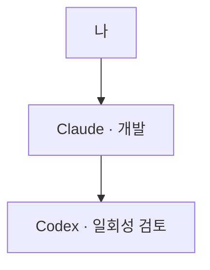
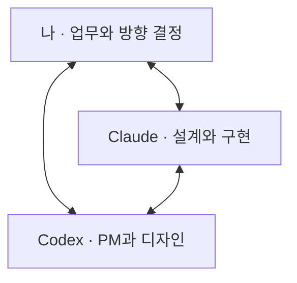

**Claude에게 개발을, Codex에게 PM과 디자인을 맡겨서 모바일 클라이언트와 서버 그리고 어드민까지 포함하는 대규모 기능개발을 진행했는데요. 같은 양의 코드를 생산하는데 제 직접 입력이 비교한 이전 작업보다 절반 이상, 근데 사용한 총 토큰은 2/3 이었습니다.**

LLM 도구를 두 개 쓰면 비용도 늘 것 같았는데, 사실은 달랐습니다. **저와 팀원들이 PR 리뷰에도 참여했기 때문에** 결과 품질도 어느 정도 확인했다고 봅니다.

단일 Agent 를 사용할 때엔 제 기준으로 60점쯤에서 시작하던 것이 이번에는 90점에 가까웠습니다. LLM 은 참 사람과 닮아 있습니다. 혼자 일할 때는 멋대로 하고.. 혼자 Test XX 개 통과했다! 설계 및 코드 기준을 통과했다며 혼자 즐거워 했는데 견제하는 똑똑한 동료가 생기니 갑자기 없던 기운이 솟아나며 서로를 보완합니다. 덕분에 다시 설명하고 고친 결과를 확인하는 제 시간도 매우 줄었는데요. 자세한 과정과 결과를 설명드려 보겠습니다.

Claude가 구현하는 동안 Codex는 주로 기다렸고, Codex가 설계와 검토를 맡으면 Claude가 그 결과를 받아 작업했습니다. 앞에서 서로 확인하는 시간이 나중에 다시 만드는 일을 줄여주는 것 같았습니다. **주요 결정은 공용 메모리에 남겨 함께 읽게** 했습니다.

대화 기록도 살펴봤습니다. 아래는 이전 작업 100개 세션과 이번 프로젝트 세션들에서 "이런 것 빠뜨린 것 같은데?", "이건 고려한 것이 맞아?" 등의 말을 한 빈도입니다.

| 항목                   | 이전 프로젝트 작업   | 이번 협업 프로젝트  |
| -------------------- | ------------: | -----------: |
| 전체 LLM 응답            | 5,312개       | 720개        |
| 재질문 혹은 빠뜨린 내용에 대한 지적 | 501개 (9.43%) | 13개 (1.81%) |

눈에 띄게 제가 지적을 하는 횟수가 줄었습니다. 좀 다른 태생의 동료가 감시하는 덕분에 훨씬 더 꼼꼼히 상황을 객관적으로 보기 시작한 것입니다.

## Before: 계산이 하나도 안 맞잖아! 하지만 빨랐죠.

코딩 에이전트에게 기능을 설명하면 실행되는 결과물까지는 꽤 빨리 나옵니다. 제 다른 글들을 보면 코드 품질에 엄청난 신경을 씁니다. LLM 은 이렇게 제가 신경을 많이 쓴 코드를 Reference 하여 기술부채가 알아서 관리될 수 있도록 하고 있습니다. 하지만 제가 원하는 완성도까지 가려면 코드와 화면을 보며 피드백을 줘야하는 일이 많았습니다.

제품 완성도도 그렇습니다. UI/UX 를 그냥 맡기면 정말 사용하기 힘든 결과를 만드는 경우가 종종 있습니다. 화장품 매장 매대를 정리하기 전에 전체 상태를 사진으로 남겨야 한다고 해보겠습니다. 한 칸씩 찍고 정리하면 편해 보이지만, 정리 전 매장 전체를 기록할 수는 없습니다. 화면에서 누르는 횟수를 줄여도 업무 순서에는 맞지 않을 수 있는 거죠.

이런 기준을 구현하는 동안에도 계속 챙길 역할이 필요했습니다. Claude가 시스템 설계와 구현을 진행하는 사이, Codex가 요구사항과 화면을 보고 제품 쪽에서 질문하도록 했습니다.

처음에는 제가 Claude에게 일을 맡기면, Claude가 필요할 때 Codex를 불러 의견을 받았습니다. 지금은 저도 Codex와 직접 이야기하고, Claude와 Codex도 서로 설계와 구현을 검토합니다. 세 주체가 각자 맡은 역할로 함께 일하는 구조입니다.

**이전: 필요할 때 호출**

**현재: 세 주체의 협업**

## 서로 다른 두 모델에게 자리를 나눠줬습니다

제가 정한 역할은 다음과 같습니다.

| 담당     | 주로 맡긴 일                            |
| ------ | ---------------------------------- |
| 나      | 현장 업무 설명, 제품 범위와 중요한 선택 결정         |
| Codex  | 요구사항 정리, 화면 흐름과 UI 시안 작성, 제품 관점 검토 |
| Claude | 시스템 설계, 구현과 테스트, 시안의 기술 검토         |

개발자는 Claude Code에서 Opus 5.5를 medium로 설정했습니다. PM은 Codex CLI에서 GPT-6.1 Sol medium이었습니다.

왜 이 배치였을까요? 두 도구와 직접 일해본 경험이 먼저였습니다. UI·UX는 Codex가 작성하고 Claude가 검토하도록 제가 요청했습니다. Codex가 만든 화면과 설명이 제가 생각한 방향에 더 잘 맞았기 때문입니다.

한국어도 이유 중 하나였습니다. 예전에 [Claude의 번역투를 고치려고 스킬을 만든 이야기](https://blog.hovans.com/korean-polish-skill/)를 쓴 적이 있습니다. "뭐라고 하는거야?" / "죄송합니다." 의 반복이었죠. Claude 를 쓸 때는 그래서 영어로 쓸 때가 많습니다. 설명을 읽고 뜻을 다시 풀어야 하는 일이 반복되다 보니, 제가 이해하기 쉬운 문장으로 이야기하는지도 중요한 선택 기준이 됐습니다. 한국어 문서는 Claude가 영어로 초안을 쓰고 Codex가 한국어로 옮기도록 나누기도 했습니다.

PM은 선택지를 정리하고, 무엇을 결정해야 하는지 설명하는 일을 자주 합니다. 두 모델 모두 개발 업무를 맡길 만하다면, 저와 더 잘 소통하는 쪽에 PM을 맡기는 것이 자연스러웠습니다. 디자인은 여기에 실제 화면 결과에 대한 선호가 더해졌고요.

## 두 창이 실제로 함께 일하는 방법

기본 흐름은 제가 현장 업무와 원하는 결과를 설명하면, Codex와 Claude가 각자 맡은 부분을 구체화하는 방식입니다. 화면과 시스템 설계는 서로 영향을 주기 때문에 한 번 넘기고 끝나지 않습니다.

**PM(Codex)**은 공통 화면 부품을 조합해 브라우저에서 직접 열어볼 수 있는 시안을 만들었습니다. **개발자(Claude)**는 그 시안을 기존 코드와 데이터 구조에 맞춰 검토했습니다. 구현하면서 제약이 드러나면 다시 화면과 동작을 조정했습니다.

반대 방향의 검토도 있었습니다. Claude가 저장 방식을 제안하면 Codex는 사용자가 보게 될 상태를 따졌습니다. Codex가 화면을 만들면 Claude는 실제로 실행되는지, 시스템에서 제공할 수 있는 동작인지 확인했습니다. 산출물에 따라 작성자와 검토자가 바뀝니다.

[pm-consult](https://github.com/urunimi/skills/tree/main/skills/pm-consult)는 두 역할이 언제 무엇을 묻고 답할지 적은 지침입니다. 착수, 설계 변경, PR 전 검토에서 어떻게 협의할지 정해두었습니다. 공통 지침과 스킬도 같은 파일을 가리키게 했습니다.

기억은 **역할별 작업 기억과 공용 장기 기억**으로 나눠 설명할 수 있습니다.

| 구분                       | 이 구조에서의 역할                                        |
| ------------------------ | ------------------------------------------------- |
| 작업 기억(Short-term memory) | 각 스레드에서 현재 읽는 문맥. PM은 요구사항·화면, 개발자는 구현·검증을 이어갑니다. |
| 장기 기억(Long-term memory)  | 두 모델이 공유하는 결정과 교훈. 대화 압축이나 새 작업 뒤에도 다시 읽습니다.      |

공용 `memory/`에는 목록인 `MEMORY.md`와 설계 순서·프로젝트 상태·PR 규칙을 담은 주제별 파일이 있습니다. Claude는 목록을 대화에 받고, Codex에는 제가 같은 경로를 읽고 쓰도록 지시했습니다. 실제로 PM이 적은 설계 메모를 개발자가 다음 작업에서 읽었습니다. 상세 설계와 검토는 별도 작업 파일과 Linear에도 남겼습니다.

한쪽이 확인한 사실을 다른 쪽이 다시 찾는 일을 줄이려는 구조입니다. 다만 메모리 자체의 절감 효과는 따로 측정하지 않았습니다. [LangChain 문서](https://docs.langchain.com/oss/python/concepts/memory)도 한 스레드 안에서 쓰는 기억과 여러 스레드가 함께 쓰는 기억으로 나눕니다.

다만 두 창만 띄워둔다고 이 흐름이 유지되지는 않습니다. 제가 메시지를 전달하거나 업무 기준을 다시 설명한 때도 있었고, 보조 리뷰 에이전트도 함께 썼습니다.

### 화면을 사용하는 리뷰어

[ux-reviewer](https://github.com/urunimi/skills/tree/main/plugins/ux-reviewer)는 Claude로 화면과 업무 흐름을 검토하는 에이전트입니다. 구현 뒤 자동 검사와 브라우저로 문제를 찾고, 수정은 구현 담당자에게 맡겼습니다.

예를 들어 목록에서 항목 하나를 고를 때마다 창이 닫히면, 여러 개를 고르는 사람은 같은 창을 계속 열어야 합니다. 작은 선택 버튼은 휴대폰에서 누르기 어렵습니다. 이런 문제를 찾아 선택을 마칠 때까지 창을 유지하고, 누를 수 있는 영역을 넓혔습니다.

이런 수정까지 포함한 결과물이므로, 품질을 Claude와 Codex 두 모델의 능력만으로 설명하면 빠지는 부분이 많습니다. 주 담당 모델 둘이 있고, 필요한 곳에 UX 검토와 실행 검증을 붙인 구조였습니다.

### 검토한 코드와 PR의 코드를 맞추기

PR을 만들기 전에는 훅으로 확인 기록을 검사했습니다. 화면 변경에는 UX 확인 기록을, 디자인 변경에는 동기화 승인 기록을 요구했습니다. 기록이 가리키는 커밋과 현재 커밋이 다르면 PR 생성을 막았습니다.

한번 검토받은 뒤 코드를 더 고쳤다면, 앞선 검토가 새 코드까지 확인한 것은 아닙니다. 확인 기록을 커밋에 묶은 이유입니다. [SOLID 위반을 훅으로 찾게 했던 방식](https://blog.hovans.com/solid-rules/)과도 이어집니다. 약속한 절차 중 기계가 확인할 수 있는 부분은 실행 조건으로 옮겼습니다.

물론 이 훅이 품질을 판정해주는 것은 아닙니다. 당시 UX 확인 표시는 자동 검사에서 차단 문제가 없으면 만들어졌고, 뒤이어 브라우저에서 찾은 모든 문제가 해결됐다는 뜻은 아니었습니다. 이 차이는 실제로 놓친 문제를 설명할 때 다시 나옵니다.

## 협업이 제품을 바꾼 순간들

아래에서는 **PM은 Codex**, **개발자는 Claude**입니다. 실제 논의를 쉽게 설명하려고, 화장품 매장 직원이 상품 수량을 세고 매장을 점검하는 앱으로 각색했습니다.

### 로션이 0개인 것과 아직 세지 않은 것

직원이 진열대를 확인했는데 로션이 하나도 없다면 “0개”입니다. 아직 진열대를 보지 않았다면 빈칸입니다. 둘을 같게 처리하면 관리자는 로션이 없는 건지, 직원이 아직 확인하지 않은 건지 알 수 없습니다. 반대로 1개 이상만 입력하게 하면 로션이 없는 매장은 점검을 끝낼 수 없습니다.

**PM**은 앞서 제안했던 “1개 이상” 조건을 다시 검토했습니다. 남은 수량은 0개일 수 있지만, 상품을 채웠다고 기록할 때의 수량은 1개 이상이어야 했습니다. **개발자**는 재고를 세는 단계에서는 0을 허용하고, 상품을 채우는 단계에서는 1 이상만 받도록 구현했습니다.

다만 질문을 어느 단계에 넣었는지로 조건이 정해지므로, 다른 뜻의 수량 질문이 섞이면 다시 혼동할 수 있습니다. **PM**은 이 한계도 함께 적어 두었습니다.

### 3개로 고쳤는데 다시 5개가 보인다면

직원이 로션 수량을 “5개”에서 “3개”로 고쳤다고 해보겠습니다. 매장 안에서 통신이 끊겨도 입력을 잃지 않도록, **개발자**는 내용을 휴대폰에 먼저 저장하고 서버로 보내는 구조를 만들었습니다.

**PM**은 서버가 저장을 마쳤다고 알려준 다음 화면에 무엇이 보이는지 짚었습니다. 전송 대기 중인 “3개”를 지우면서 휴대폰에 남은 예전 사본을 갱신하지 않으면, 화면에 다시 “5개”가 나타날 수 있었습니다. 서버에는 저장됐는데 직원은 저장에 실패했다고 느끼는 겁니다.

**개발자**는 휴대폰의 사본을 갱신하는 일과 전송 대기 항목을 지우는 일을 함께 처리하도록 고쳤습니다. 기다리는 사이 직원이 “4개”로 다시 바꿨다면 그 최신 입력을 남기자는 **PM**의 제안도 반영했습니다.

**PM**이 사용자가 보게 될 결과를 따지고, **개발자**가 저장 순서를 고쳐 그 결과를 맞춘 사례입니다.

### 볼 수 있는 매장이 전부 내 담당은 아닙니다

본사 관리자는 모든 매장의 점검 결과를 볼 수 있습니다. 그렇다고 그 매장을 전부 직접 점검하는 것은 아닙니다. “내 담당 매장” 화면에 전체 매장을 보여주면, 자신이 어디를 확인해야 하는지 알기 어렵습니다.

**개발자**는 사용자별 대상 목록을 가져올 데이터가 없다고 봤습니다. **PM**이 코드를 확인해 목록을 찾아냈지만, 동시에 그것은 볼 권한이지 담당 정보가 아니라는 점도 짚었습니다.

그래서 “내 담당”을 추측하지 않고, 제가 동의한 뒤 전체 목록으로 시작했습니다. **PM**이 코드의 사실관계와 데이터의 뜻을 함께 확인해 설계 근거를 바로잡은 사례입니다.

## 두 모델을 쓴다고 비용도 두 배가 될까?

두 모델을 함께 쓴다고 하면 비용부터 떠오릅니다. 제 경험에서는 첫 결과물을 받기까지의 시간은 조금 늘었습니다. 화면과 설계를 먼저 맞추고 검토하는 시간이 추가되니까요.

대신 처음 받아보는 결과물의 완성도가 달랐습니다. 도입부의 60점과 90점은 정식 평가가 아니라 이 체감 차이를 표현한 것입니다.

Claude가 구현할 때 Codex는 주로 기다리고, Codex가 설계하거나 검토할 때는 Claude가 답을 기다리는 식으로 진행했습니다. 기다리는 동안 다른 준비를 하거나 보조 에이전트를 쓰기도 했으므로 모든 순간에 하나만 실행된 것은 아닙니다. 그래도 두 모델에게 제품 전체를 각각 만들게 한 구조는 아니었습니다.

제가 가장 분명하게 느낀 이득은 **제 시간이 줄었다는 것**입니다. 구현 뒤 화면과 동작을 크게 고치는 대신, 앞에서 조건을 맞추는 데 시간을 썼습니다. 원하는 완성도까지 가는 동안 제가 계속 붙어서 설명하고 다시 지시하는 부담이 줄었습니다. 에이전트의 전체 실행 시간과 토큰도 줄었다고 느꼈지만, 보조 에이전트까지 포함한 총사용량을 동일 조건에서 비교하지는 않았습니다.

제 개입이 기록에도 드러나는지 보려고, 협업 도입 전 다른 작업 20개 세션과 이번 프로젝트 전체를 비교했습니다. 코드량은 병합된 제품 코드와 테스트의 추가·삭제 합계이며, 시안·문서·번역 파일은 뺐습니다. 입력은 직접 채팅과 질문 창 답변을 합했고, 두 모델 사이의 메시지는 제외했습니다.

| 구분  | 코드 변경량  | 제 직접 입력 | **1만 줄당 입력** | 기록상 토큰 합계 | **1만 줄당 토큰** |
| --- | -------: | -------: | ------------: | ---------: | ------------: |
| 이전  | 8,883줄  | 196회    | **220.6회**   | 14.29억    | **16.08억**   |
| 이후  | 18,631줄 | 170회    | **91.2회**    | 19.80억    | **10.63억**   |

입력에는 승인·진행 요청과 아직 병합되지 않은 작업의 지시도 들어갑니다. 이 비교에서 **코드 1만 줄당 제 직접 입력은 58.6% 적었습니다.** 제 시간이 줄었다는 경험을 뒷받침하지만, 화면을 읽고 판단한 시간까지 잰 것은 아니므로 시간 절감률을 뜻하지는 않습니다. 제가 경험한 것은 **이 역할 분담과 검토 방식을 함께 썼을 때의 이득**이라고 생각합니다.

토큰도 같은 세션의 기록으로 셌습니다. 이전은 Claude, 이후는 Claude와 Codex를 합쳤고, 양쪽 모두 남아 있는 보조 에이전트 기록을 포함했습니다. 이후 합계 중 Claude가 19.12억, Codex가 0.68억입니다. **코드 1만 줄당으로는 33.9% 적었습니다.** 캐시를 빼고 모델이 생성한 출력만 보면 1만 줄당 약 410만에서 226만 토큰으로 줄었습니다.

비교할 만한 사례로 Anthropic의 [애플리케이션 개발 harness 글](https://www.anthropic.com/engineering/harness-design-long-running-apps)이 있습니다. 여기서 harness는 모델이 작업을 이어가도록 계획, 도구, 검증과 실행 흐름을 묶은 환경입니다. 이 사례도 계획·구현·평가 역할을 나눴지만, 모두 같은 모델 계열을 썼습니다.

글에 공개된 DAW 제작 실험은 3시간 50분, 124.70달러가 들었습니다. 비용 표를 합치면 구현과 재구현에 113.85달러, 약 91%를 썼습니다. 토큰 총량은 공개하지 않았고, 과제도 달라 제 앱과 비용을 직접 비교할 수는 없습니다. 그래도 어떤 작업을 얼마나 반복했는지 살펴봐야 한다는 점은 참고할 만했습니다.

그쪽도 단계를 나눠 작업했으므로 번갈아 일한다는 것만으로 제 방식의 차이를 설명하기는 어렵습니다. 제가 시도한 것은 서로 다른 회사의 모델에게 지속적인 제품 책임을 나누고, 각자 맡은 결과물을 상대가 검토하도록 운영하는 방식이었습니다.

## 팀워크가 너무 잘 맞을 때

예상보다 두 모델이 열심히 협력해서 생긴 문제도 있었습니다. 한쪽이 구조를 제안하면 다른 쪽은 조건과 예외를 보완했습니다. 같은 가정에서 출발하면, 그 구조가 꼭 필요한지보다 완성도를 높이는 데 집중하기도 했습니다.

### 사진을 따로 관리하자 예외도 늘었습니다

이번 프로젝트에서는 **개발자**가 점검 결과와 사진을 따로 관리하는 구조를 제안했습니다. 사진이 올라오는 중에 직원이 삭제하면 어떻게 할지 같은 문제가 따라왔고, **PM**은 그 예외들을 다듬었습니다. 제가 사진을 점검 결과에 바로 붙이면 충분하지 않느냐고 묻자, 별도 구조와 그 때문에 생긴 문제를 함께 없앨 수 있었습니다.

둘은 서로의 설계를 보완하고 있었습니다. 다만 선택한 구조 안에서 문제를 풀다 보니, 구조 자체를 단순하게 만들 기회를 놓쳤습니다. 협업이 잘될수록, 처음의 가정도 함께 단단해질 수 있었습니다.

### Clean Architecture에도 적용 범위가 있습니다

한 역할이 설계 원칙을 넓게 적용한 경우도 있었습니다. 다른 작업을 매장 업무로 바꿔보면, 직원에게 공지를 보내는 보조 기능을 재고·주문 같은 핵심 업무 코드와 함께 둔 셈입니다. **개발자**는 설계 규칙을 따랐지만, 팀원은 리뷰에서 업무를 돕는 알림까지 핵심 기능과 함께 관리할 필요가 있느냐고 짚었습니다. 이후 운영 보조 코드 쪽으로 옮겼습니다.

**PM**은 기능 범위와 완료 기준을 검토했고, 코드 위치는 사람의 리뷰에서 바로잡았습니다. 제게는 기능의 성격보다 설계 틀에 충실했던, Clean Architecture 과적합 사례였습니다.

그래서 **“이 구조가 꼭 필요한가”**도 물어야 했습니다. 합의한 작업 순서를 **PM**이 다음 대화에서 다시 잘못 이해해 제가 바로잡은 일도 있었습니다. 서로의 설계를 다듬는 동안에도 처음의 목적과 업무 기준은 계속 확인해야 했습니다.

이번 작업에서 저는 Codex의 한국어 설명과 화면 설계를 보며 제품 방향을 판단하고, Claude가 구현한 결과를 다시 함께 확인하는 방식이 잘 맞았습니다. 같은 요구를 두 모델이 서로 다른 자리에서 검토하니 제가 원하는 완성도에 더 가까운 결과물을 받을 수 있었습니다.

앞으로도 이 역할 분담은 유지하려고 합니다. 다만 두 모델의 동의나 PASS 표시를 받았을 때는 한 가지를 더 보려고 합니다. 실제로 어떤 데이터와 화면에서, 어떤 행동까지 확인했는지요.