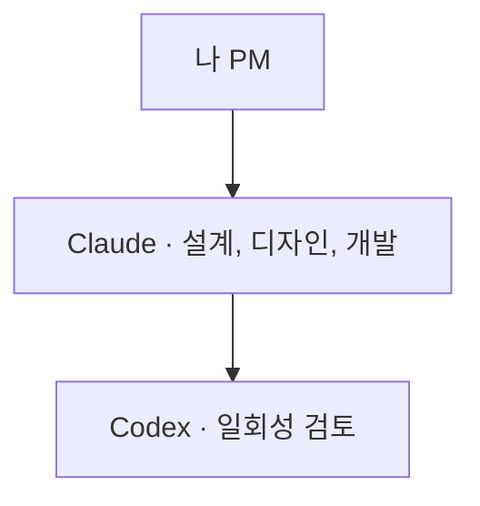
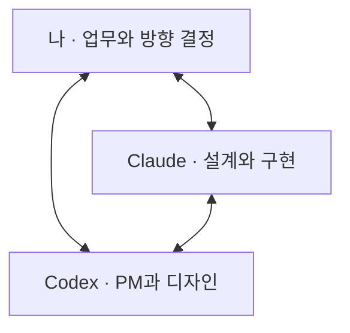
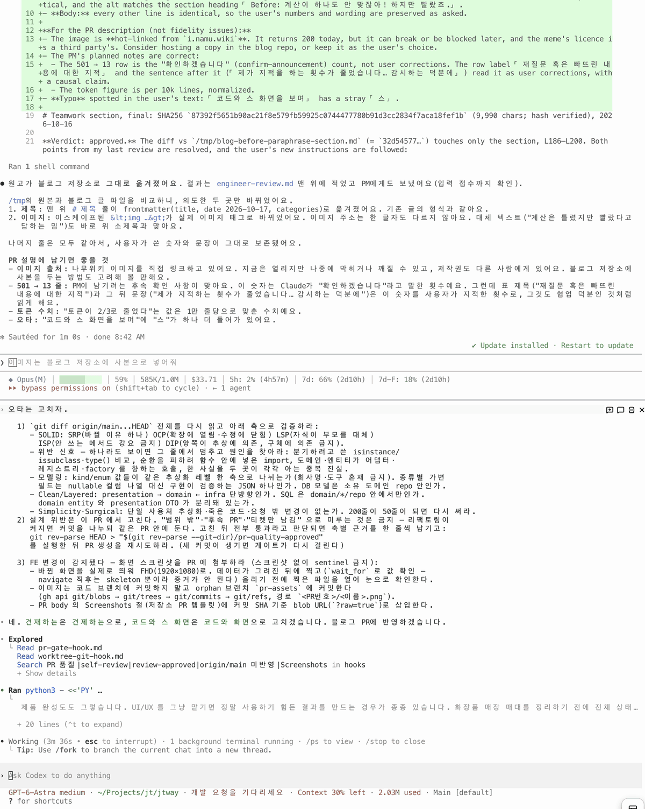
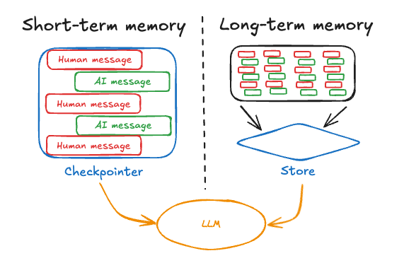

**Claude에게 개발을, Codex에게 PM과 디자인을 맡겨서 모바일 클라이언트와 서버 그리고 어드민까지 포함하는 대규모 기능개발을 진행했는데요. 같은 양의 코드를 생산하는데 제 직접 입력이 비교한 이전 작업보다 절반 이상, 근데 사용한 총 토큰은 2/3 이었습니다.**

LLM 도구를 두 개 쓰면 비용도 늘 것 같았는데, 사실은 달랐습니다. **저와 팀원들이 PR 리뷰에도 참여했기 때문에** 결과 품질도 어느 정도 확인했다고 봅니다.

단일 Agent 를 사용할 때엔 제 기준으로 60점쯤에서 시작하던 것이 이번에는 평균이 90점에 가까웠고, 가끔 110점짜리 결과를 돌려주었습니다. 자세한 과정과 결과를 설명드려 보겠습니다.

대화 기록도 살펴봤습니다. 아래는 이전 작업 100개 세션과 이번 프로젝트 세션들에서 "이런 것 빠뜨린 것 같은데?", "이건 고려한 것이 맞아?" 등의 말을 한 빈도입니다.

| 항목                   | 이전 프로젝트 작업   | 이번 협업 프로젝트  |
| -------------------- | ------------: | -----------: |
| 전체 LLM 응답            | 5,312개       | 720개        |
| 재질문 혹은 빠뜨린 내용에 대한 지적 | 501개 (9.43%) | 13개 (1.81%) |

눈에 띄게 제가 지적을 하는 횟수가 줄었습니다. 좀 다른 태생의 동료가 감시하는 덕분에 훨씬 더 꼼꼼히 상황을 객관적으로 보기 시작한 것입니다.

## 두 모델을 쓴다고 비용도 두 배가 될까?

두 모델을 함께 쓴다고 하면 비용부터 떠오릅니다. 하지만 제가 가장 분명하게 느낀 이득은 **제 시간이 줄었다는 것**입니다. 여기에 더 놀라운 점은 Fable, 이나 Astra 등의 고수준 모델을 사용하는 빈도가 현격히 줄었습니다. (LLM 을 활용할 땐, 시니어 한 명보다 다른 주니어 2명이 낫다?)  즉, 원하는 완성도까지 가는 동안 제가 계속 붙어서 설명하고 다시 지시하는 부담이 현격히 줄었고 첫 프롬프트로 받아보는 결과물의 완성도가 훨씬 좋았기 때문에 "토큰 사용량" 과 "저의 입력 프롬프트 횟수" 에 대해 정량화 봐야겠다 생각했습니다.

제 개입이 기록에도 드러나는지 보려고, 협업 도입 전 다른 작업 20개 세션과 이번 프로젝트 전체를 비교했습니다. 

| 구분  | 코드 변경량  | 제 직접 입력 | **1만 줄당 입력** | 기록상 토큰 합계 | **1만 줄당 토큰** |
| --- | -------: | -------: | ------------: | ---------: | ------------: |
| 이전  | 8,883줄  | 196회    | **220.6회**   | 14.29억    | **16.08억**   |
| 이후  | 18,631줄 | 170회    | **91.2회**    | 19.80억    | **10.63억**   |

이 비교에서 **코드 1만 줄당 제 직접 입력은 58.6% 적었습니다.** 제가 경험한 것은 **이 역할 분담과 검토 방식을 함께 썼을 때의 이득**이라고 생각합니다.

토큰 사용량도 **코드 1만 줄당으로는 33.9% 적었습니다.** 캐시를 빼고 모델이 생성한 출력만 보면 1만 줄당 약 410만에서 226만 토큰으로 절반 가까지 줄었습니다.

Claude가 구현하는 동안 Codex는 주로 기다렸고, Codex가 설계와 검토를 맡으면 Claude가 그 결과를 받아 작업했습니다. 앞에서 서로 확인하는 시간이 나중에 다시 만드는 일을 줄여주는 것 같았습니다.

Anthropic도 [Claude 여러 명에게 기획, 개발, 검사를 나눠 맡겼습니다](https://www.anthropic.com/engineering/harness-design-long-running-apps). 혼자 만들 때보다 결과는 좋아졌지만, 똑같이 놓친 문제도 있었습니다. **같은 AI에게 역할만 다르게 준다고, 서로가 놓친 것을 꼭 찾아내는 것은 아니었습니다.**

그래서 저는 서로 다른 회사의 AI를 함께 써봤습니다. 사람도 생각이 다른 친구와 문제를 풀면 혼자서는 못 보던 것을 발견하곤 합니다. Claude가 “이 정도면 됐지” 하고 넘긴 부분을 Codex가 “그런데 이건 왜 이렇게 했어?”라고 물어봤습니다.

이런 차이가 어디서 왔는지 설명하려면, 먼저 혼자 일하는 에이전트에게 제가 어떤 일을 반복해서 요구했는지 돌아봐야 합니다.

## Before: 코드가 엉망진창이잖아! 하지만 빨랐죠.

코딩 에이전트에게 기능을 설명하면 실행되는 결과물까지는 꽤 빨리 나옵니다. 제 다른 글들을 보면 코드 품질에 엄청난 신경을 쓰고 있는데요. 코드 품질을 꾸준히 관리한 덕분에 제가 사용하는 코딩 도구들은 신경을 많이 쓴 코드를 Reference 하여 기술부채가 알아서 관리될 수 있도록 하고 있습니다. 하지만 새로 추가되는 코드는 엔트로피가 늘 증가하는 것처럼 제가 직접 코드와 화면을 보며 피드백을 줘야하는 일이 많았습니다. 

> "Table 하나에 Column 이 왜 이렇게 많은거야, 다 필요한 것 맞아?"  
> "A랑 B는 중복정보잖아. 이러면 무결성이 깨지지."  
> "이 코드가 도메인에 있으면 안 되지 Repsotiory 구현체로 옮겨." 

정말 많은 마이크로매니징이 필요했습니다. 아무리 코드 품질을 관리하는 Gate 를 두어도 **스스로에 관대한 Claude 는 언제나 Self 통과** 시켜버렸습니다.

제품 완성도도 그렇습니다. UI/UX 를 그냥 맡기면 정말 사용하기 힘든 결과를 만드는 경우가 종종 있습니다. Claude 혼자서는 기상천외한 UI 를 많이 만들어 내었는데요. 아무리 PRD 및 시스템 설계 문서를 꼼꼼하게 챙겨도 실제 구현된 UI 는 사용성을 전혀 고려하지 않은 것들 투성이였죠. 저는 예전부터 UI/UX 서적들을 많이 읽으며 기본적으로 가지고 있던 지식이 있었고, 이런 기준 하에서 설계를 하기 위해 역시 hook / sub agent 등 여러 도구를 활용했지만 언제나 스스로에게 관대한 Claude 는 "완벽합니다!" 라고 말하기 일수 였습니다.

이런 기준을 구현하는 동안에도 계속 챙길 역할이 필요했습니다. Claude가 시스템 설계와 구현을 진행하는 사이, Codex가 요구사항과 화면을 보고 제품 쪽에서 질문하도록 했습니다. Claude 에 Codex plugin 을 설치해서 쓰시는 분들도 계실 겁니다. 처음에는 제가 Claude에게 일을 맡기면, Claude가 필요할 때 Codex를 불러 의견을 받는 구조였죠. 기존 구조는 마치 "팀장" - "파트장" - "팀원" 이 한 명씩 있는 구조라 팀장이 팀원한테 말걸려고 하면 파드장이 이렇게 말하는 것과 같습니다.

> 파트장: "제 팀원과 직접 소통하시면 안 되고요. 저를 거치셔야 합니다."

하지만 지금은 저도 Codex와 직접 이야기하고, Claude와 Codex도 서로 설계와 구현을 검토합니다. 생각해보면 이게 **인간들이 팀으로 일을 할 때에도 훨씬 자연스러운 구조**입니다. 세 주체가 각자 맡은 역할을 하는데 독립적으로 소통이 가능한거죠. 

**이전: 필요할 때 호출**

**현재: 세 주체의 협업**

## 팀원들이 협업하는 방법

세 주체가 직접 소통할 수 있게 한 다음에는, 각자 무엇을 맡고 어떻게 서로 검토할지 정했습니다.

### 서로 다른 두 모델에게 자리를 나눠줬습니다

제가 정한 역할은 다음과 같습니다.

| 담당     | 주로 맡긴 일                            |
| ------ | ---------------------------------- |
| 나      | 현장 업무 설명, 제품 범위와 중요한 선택 결정         |
| Codex  | 요구사항 정리, 화면 흐름과 UI 시안 작성, 제품 관점 검토 |
| Claude | 시스템 설계, 구현과 테스트, 시안의 기술 검토         |

개발자는 Opus 5.5 medium, PM은 GPT-6.1 Sol medium 를 사용 중입니다.

왜 이 배치였을까요? 두 도구와 직접 일해본 경험이 먼저였습니다. UI·UX를 Codex에게 맡긴 것은 그쪽이 만든 화면과 설명이 제가 생각한 방향에 더 잘 맞았기 때문입니다.

한국어도 이유 중 하나였습니다. 예전에 [Claude의 번역투를 고치려고 스킬을 만든 이야기](https://blog.hovans.com/korean-polish-skill/)를 쓴 적이 있습니다. "뭐라고 하는거야?" / "죄송합니다." 의 반복이었죠. Claude 를 쓸 때는 그래서 영어로 쓸 때가 많습니다. 설명을 읽고 뜻을 다시 풀어야 하는 일이 반복되다 보니, 제가 이해하기 쉬운 문장으로 이야기하는지도 중요한 선택 기준이 됐습니다. 한국어 문서는 Claude가 영어로 초안을 쓰고 Codex가 한국어로 옮기도록 나누기도 했습니다.

PM은 선택지를 정리하고, 무엇을 결정해야 하는지 설명하는 일을 자주 합니다. 두 모델 모두 개발 업무를 맡길 만하다면, 저와 더 잘 소통하는 쪽에 PM을 맡기는 것이 자연스러웠습니다. 디자인은 여기에 실제 화면 결과에 대한 선호가 더해졌고요.

기획과 디자인 단계에서는 제가 원하는 결과를 **PM(Codex)**에게 설명했습니다. PM이 공통 화면 부품으로 만든 시안을 브라우저에서 함께 보고, **개발자(Claude)**는 기존 코드와 데이터 구조에 맞는지 검토했습니다. 개발에 들어가면 주로 개발자와 이야기하고 PM이 요구사항과 화면을 확인하도록 했습니다.

담당은 나눴지만 서로의 결과물에는 의견을 주도록 했습니다. 구현 중 제약이 드러나면 화면과 동작을 다시 조정하고, 합의가 안 되면 중단하고 저에게 중재를 요청하도록 했습니다.

*위는 Claude, 아래는 Codex입니다. PM(하단의 Codex) 에게 요구사항을 이야기했기 때문에 Codex의 검토 요청에 Claude가 수정 내용을 확인해 답하고, Codex가 다음 검토를 요청하는 장면입니다. 역할 구분에 따라 명확히 동작합니다.*

[pm-consult](https://github.com/urunimi/skills/tree/main/skills/pm-consult)는 두 역할이 언제 무엇을 묻고 답할지 적은 지침입니다. 착수, 설계 변경, PR 전 검토에서 어떻게 협의할지 정해두었습니다. 

### 공용 기억 저장소와 개별기억 저장소의 활용

역할을 나눈 뒤에는 함께 정한 내용을 어떻게 기억할지도 정했습니다. 사람으로 구성된 팀처럼, 각자 작업에 필요한 문맥은 따로 두고 함께 알아야 할 결정은 공유하도록 했습니다.

| 구분                       | 이 구조에서의 역할                                        |
| ------------------------ | ------------------------------------------------- |
| 작업 기억(Short-term memory) | 각 스레드에서 현재 읽는 문맥. PM은 요구사항·화면, 개발자는 구현·검증을 이어갑니다. |
| 장기 기억(Long-term memory)  | 두 모델이 공유하는 결정과 교훈. 대화 압축이나 새 작업 뒤에도 다시 읽습니다.      |

공용 `memory/`에는 목록인 `MEMORY.md`와 설계 순서·프로젝트 상태·PR 규칙을 담은 주제별 파일이 있습니다. Claude는 목록을 대화에 받고, Codex에는 제가 같은 경로를 읽고 쓰도록 지시했습니다. 실제로 PM이 적은 설계 메모를 개발자가 다음 작업에서 읽었습니다. 상세 설계와 검토는 별도 작업 파일과 Linear에도 남겼습니다.

[LangChain 문서](https://docs.langchain.com/oss/python/concepts/memory)도 한 스레드 안에서 쓰는 기억과 여러 스레드가 함께 쓰는 기억으로 나누는데 한쪽이 확인한 사실을 다른 쪽이 다시 찾는 일을 줄이려는 구조입니다. 

*한 대화 안의 기억과 여러 대화에서 함께 쓰는 기억을 비교한 개념 그림. 출처: [LangChain — Memory overview](https://docs.langchain.com/oss/python/concepts/memory).*

### 화면을 사용하는 리뷰어

역할을 나누고 결정을 공유하는 것만으로는 충분하지 않았습니다. 실제 화면과 결과물을 확인할 장치도 필요했습니다.

[ux-reviewer](https://github.com/urunimi/skills/tree/main/plugins/ux-reviewer)는 UI 화면과 실행 흐름(UX)을 검토하는 에이전트입니다. 구현 뒤 자동 검사와 브라우저로 문제를 찾고, 수정은 구현 담당자에 위임하도록 설계했는데 실제 이 Sub agent 덕분에 상당히 좋은 UI/UX 품질을 보장하고 있어서 별도 Article 정리해보겠습니다. (커밍 쑨!)

### 검토한 코드와 PR의 코드를 맞추기

PR을 만들기 전에는 훅으로 확인 기록을 검사했습니다. 화면 변경에는 UX 확인 기록을, 디자인 변경에는 동기화 승인 기록을 요구했습니다. 기록이 가리키는 커밋과 현재 커밋이 다르면 PR 생성을 막았습니다.

한번 검토받은 뒤 코드를 더 고쳤다면, 앞선 검토가 새 코드까지 확인한 것은 아닙니다. 확인 기록을 커밋에 묶은 이유입니다. 약속한 절차 중 기계가 확인할 수 있는 부분은 실행 조건으로 옮겼습니다.

물론 이 훅이 품질을 판정해주는 것은 아닙니다. 당시 UX 확인 표시는 자동 검사에서 차단 문제가 없으면 만들어졌고, 뒤이어 브라우저에서 찾은 모든 문제가 해결됐다는 뜻은 아니었습니다.

## 혼자였다면 놓치기 쉬웠을 순간들

이 방식으로 서로 검토하면서 실제 제품의 동작을 바꾼 순간들이 있었습니다. 아래에서는 **PM은 Codex**, **개발자는 Claude**입니다. 실제 논의를 쉽게 설명하려고, 화장품 매장 직원이 상품 수량을 세고 매장을 점검하는 앱으로 각색했습니다.

### 3개로 고쳤는데 다시 5개가 보인다면

직원이 로션 수량을 “5개”에서 “3개”로 고쳤다고 해보겠습니다. 매장 안에서 통신이 끊겨도 입력을 잃지 않도록, **개발자**는 내용을 휴대폰에 먼저 저장하고 서버로 보내는 구조를 만들었습니다.

**PM**은 서버가 저장을 마쳤다고 알려준 다음 화면에 무엇이 보이는지 짚었습니다. 전송 대기 중인 “3개”를 지우면서 휴대폰에 남은 예전 사본을 갱신하지 않으면, 화면에 다시 “5개”가 나타날 수 있었습니다. 서버에는 저장됐는데 직원은 저장에 실패했다고 느끼는 겁니다.

**개발자**는 휴대폰의 사본을 갱신하는 일과 전송 대기 항목을 지우는 일을 함께 처리하도록 고쳤습니다. 기다리는 사이 직원이 “4개”로 다시 바꿨다면 그 최신 입력을 남기자는 **PM**의 제안도 반영했습니다.

**PM**이 사용자가 보게 될 결과를 따지고, **개발자**가 저장 순서를 고쳐 그 결과를 맞춘 사례입니다.

### 볼 수 있는 매장이 전부 내 담당은 아닙니다

본사 관리자는 모든 매장의 점검 결과를 볼 수 있습니다. 그렇다고 그 매장을 전부 직접 점검하는 것은 아닙니다. “내 담당 매장” 화면에 전체 매장을 보여주면, 자신이 어디를 확인해야 하는지 알기 어렵습니다.

**개발자**는 사용자별 대상 목록을 가져올 데이터가 없다고 봤습니다. **PM**이 코드를 확인해 목록을 찾아냈지만, 동시에 그것은 볼 권한이지 담당 정보가 아니라는 점도 짚었습니다.

그래서 “내 담당”을 추측하지 않고, 제가 동의한 뒤 전체 목록으로 시작했습니다. **PM**이 코드의 사실관계와 데이터의 뜻을 함께 확인해 설계 근거를 바로잡은 사례입니다.

## 팀워크가 너무 잘 맞을 때

둘은 분명 서로를 보완 했으나 기대보다 열심히 협력해서 생긴 문제도 있었습니다. 한쪽이 구조를 제안하면 다른 쪽은 조건과 예외를 보완하다보니 서로 경쟁하느라 완성도를 과적합 수준까지 높이는 데 집중하기도 했습니다.

### 예외의 예외의 예외의 예외의...

이번 프로젝트에서는 **개발자**가 점검 결과와 사진을 따로 관리하는 구조를 제안했습니다. 사진이 올라오는 중에 직원이 삭제하면 어떻게 할지 같은 문제가 따라왔고, **PM**은 그 예외들을 다듬었습니다. 다행히 이렇게 평행선을 달릴 때, 저에게 질문을 하도록 했고 제가 적당히 하자(=사진을 점검 결과에 바로 붙이면 충분하지 않느냐)고 말해서 정리할 수 있었는데 그게 아니라면 그냥 발산할 수도 있겠습니다.

### Clean Architecture에도 적용 범위가 있습니다

한 역할이 설계 원칙을 넓게 적용한 경우도 있었습니다. 서비스 로직과는 상관 없는 Cronjob 코드를 추가했는데 처음에는 한 파일짜리 코드였는데 서로 리뷰를 거쳐 서비스 로직 까지 최적화하며 전반적인 코드 재설계를 해왔습니다. 물론 PR 에 제가 단순하게 가도록 피드백을 주어 단순한 코드로 수정 했지만 하나의 공통지시 ([AGENTS.md](http://AGENTS.md)) 에 있는 설계 규칙을 둘이 동시에 읽고 피드백을 주고 받으면서 생긴 과적합 케이스였습니다.

LLM도 함께 일하는 동료가 생기니 때로는 지나칠 만큼 서로를 보완하더군요. 덕분에 제가 반복해서 설명하고 수정을 챙기는 부담이 줄었습니다. 앞으로도 이 역할 분담으로 함께 일해보려고 합니다.
