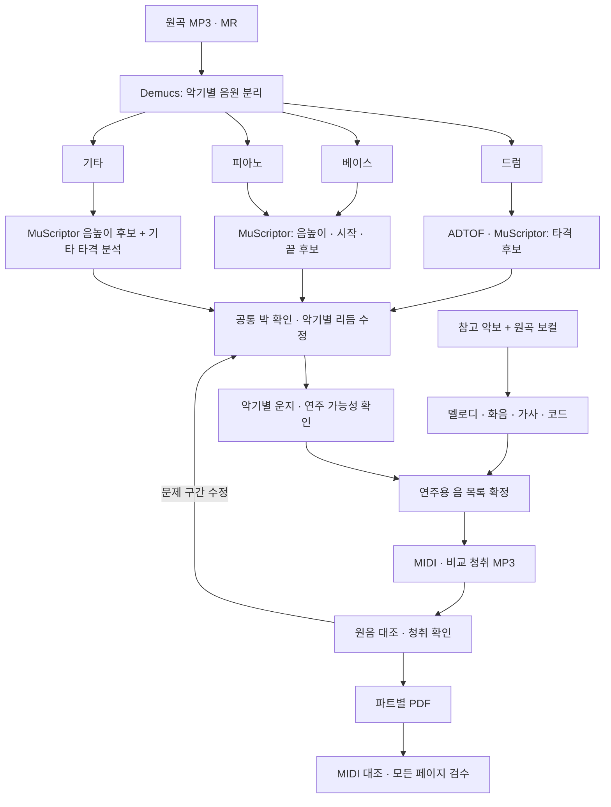
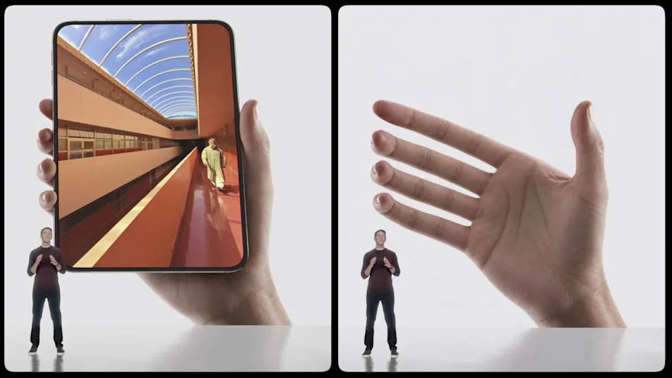

밴드 합주에 쓸 악보가 필요했습니다. 저는 기타를 맡았고, 함께 연주할 드럼·베이스·피아노 악보도 있어야 했습니다. 원곡과 MR, 참고 악보를 주면 AI가 악기별로 음을 따서 정리해줄 수 있지 않을까 싶었습니다.

처음부터 완성 악보를 한 번에 만들기보다는, 전체 과정을 한 번 돌려 어떤 문제가 생기는지 먼저 확인하기로 했습니다. 그다음 음높이, 박자, 운지, 지면 배치처럼 문제를 나눠 고치려고 했습니다. 실제로 기타에는 손으로 잡을 수 없는 화음이 나왔고, MIDI에는 원곡에 없는 반복이 있었습니다. 글자를 키우면 가사가 겹치고, 운지 그림을 키우면 악보가 다섯 장으로 늘어나는 문제도 있었습니다.

이 작업을 Claude와 Codex에게 나눠 맡기면서, 제가 고쳐달라고 한 내용을 [band-score 스킬](https://github.com/urunimi/skills/tree/main/skills/band-score)에 모았습니다. 마지막에는 **완성한 악보를 다시 만들게 하는 실험을 다섯 번 돌려, 지침을 더 길게 쓰지 않고도 결과가 나아지는지** 확인했습니다.

## MP3에서 파트 악보까지

작업은 아래처럼 나눴습니다. MP3를 악기별 음원으로 분리한 다음, 각 악기를 음표 후보로 바꾸고 박자와 운지를 다듬어 악보로 만듭니다. 보컬 멜로디·화음·가사는 참고 악보를 읽고 원곡과 대조했습니다.

모델마다 맡긴 일이 다릅니다. [Demucs](https://github.com/facebookresearch/demucs)는 섞인 소리를 악기별로 분리합니다. [MuScriptor의 large 모델](https://huggingface.co/MuScriptor/muscriptor-large)은 음악에서 악기별 음표 이벤트를 추출하는 모델입니다. 이번 작업에서는 맥에서 로컬로 실행했고, 베이스·피아노의 음높이와 음 길이를 얻는 주된 출처로 썼습니다. 모델이 여러 악기를 다룰 수 있다는 점과, 각 악기의 결과를 그대로 악보로 써도 된다는 것은 구분했습니다.

| 모델 포함 도구             | 역할               | 검증                      |
| -------------------- | ---------------- | ----------------------- |
| Demucs `htdemucs_6s` | 악기별 음원 분리        | 원곡·MR·다른 분리 음원과 대조      |
| MuScriptor           | 악기별 음높이·시작·끝 후보  | 실제 타격, 배음, 음 길이 확인      |
| basic-pitch          | 대안 음표 후보         | MuScriptor와 프레이즈 단위 비교  |
| ADTOF                | 드럼 타격·종류 후보      | 드럼 분리 음원의 타격과 대조        |
| pYIN·파형·음대역 분석       | 의심 구간의 음높이·타격 진단 | 단독 정답으로 쓰지 않고 다른 근거와 비교 |
| 참고 악보                | 보컬 멜로디·화음·가사     | 원곡 보컬과 대조               |
| LilyPond             | 확정한 음 목록을 악보로 출력 | 모든 페이지의 표기·겹침 확인        |

분리한 소리를 들어보면 베이스가 꽤 잘 들렸습니다. 하지만 그 소리를 음표로 바꾼 결과까지 맞는 것은 아니었습니다. 낮은 베이스 음의 배음을 다른 음으로 읽어, 한 옥타브 높은 음을 넣는 일이 있었습니다. 원음은 괜찮게 분리했는데 그 뒤 단계에서 틀린 겁니다.

그래서 분리 단계와 악보 단계를 나눴습니다. 소리 분리는 원본·MR·악기별 음원과 시간 정보를 남기고, 악보 쪽은 그 자료를 읽어 음표와 코드를 만듭니다. 운지나 글자 크기를 고쳤다고 음원 분리부터 다시 돌릴 이유는 없습니다.

이 구분은 복구에도 필요했습니다. 작업 중 맥을 재시동하면서 `/tmp`에 두었던 중간 파일들이 사라졌습니다. 이후에는 원본 음원, 모델의 원시 출력, 승인한 후보, 편집 시간표를 곡별 작업 폴더에 보존하도록 바꿨습니다. 대화에 결과 수치가 남아 있어도 원시 자료가 없으면 같은 결과를 재현하기가 어렵습니다.

## 모델은 음을 따고, 에이전트는 조화를 구성

이 작업은 앞서 정리한 [Claude·Codex 페어 협업](https://blog.hovans.com/claude-codex-collaboration/) 위에서 진행했습니다. 기본은 한쪽이 작업하고 다른 쪽이 독립적으로 확인하는 방식입니다. 이번에는 Codex도 직접 구현했으므로 개발자와 PM을 고정하기보다 악기와 산출물에 따라 담당을 나눴습니다.

| 담당                 | 이번 작업에서 맡은 일                                            |
| ------------------ | ------------------------------------------------------- |
| MuScriptor 등 음향 모델 | 분리 음원에서 음높이·시각·악기 종류 후보 생성                              |
| Claude             | 베이스·피아노 후보 추출, 기타 타격의 독립 분석, Codex가 만든 합본 MIDI와 PDF 검수  |
| Codex              | 드럼·기타 후보 조립과 수정, 합본 MIDI·비교 음원·악보 제작, Claude의 후보와 근거 검수 |
| 나                  | 비교 음원 청취, 실제 연주 조건 설명, 채보에서 편곡으로 바꿀 범위 결정 😎            |

MuScriptor의 장점은 음마다 주파수를 직접 판정하는 대신, 음높이와 시작·끝을 갖춘 후보를 얻을 수 있다는 점이었습니다. 이번 곡의 베이스와 피아노에서는 청취 결과도 좋았습니다. Claude와 Codex는 그 후보를 실제 소리와 비교하고, 사람이 고를 수 있는 비교 음원과 연주 가능한 악보로 만드는 일을 맡았습니다.

기타에서는 모델의 음높이 후보와 리듬을 따로 다뤄야 했습니다.

MIDI를 MP3로 만들어 들어보니 어떤 구간에서는 기타가 마구 긁는 것처럼 들렸습니다. 처음에는 GarageBand에서 재생할 때 밀리는 것인지 의심했습니다. 다른 음원으로 렌더한 MP3와 MIDI 시각을 대조하니, 시간이 갈수록 재생이 밀리는 문제는 아니었습니다. 음표가 처음부터 잘못된 자리에 있었습니다.

한 구간에서는 기타 화음을 약 0.16초 간격으로 반복했습니다. 90 BPM에서 16분음표는 약 0.1667초입니다. 한 번의 차이는 작지만 반복되면 박에서 점점 벗어납니다. 더 큰 문제는 **분리한 기타 소리에 그만큼의 타격이 없었다는 것**입니다. 음표를 격자에 붙이는 것만으로 해결할 수 없었습니다.

다시 분리한 기타 소리, MR 전체, 원곡에서 분리한 기타 소리로도 시도했습니다. 지적했던 반복은 남았습니다. 이 곡의 기타에서는 MuScriptor가 내놓은 리듬을 그대로 믿기 어려웠습니다.

그래서 스킬에 “MuScriptor를 쓴다”만 적지 않았습니다. 베이스와 피아노는 우선 후보로 사용하되 곡마다 들어보고, 기타는 음높이 후보와 실제 타격을 따로 확인하도록 했습니다. 드럼도 다른 모델과 비교합니다. 한 악기에서 좋았다는 이유로 나머지 악기까지 같은 결정을 내리지 않게 했습니다.

## 기타의 음높이와 박자를 따로 다루기

기타 박자를 고칠 때는 Claude가 분리 음원에서 타격 시작과 피크, 같은 순간 다른 악기의 소리, 불확실한 지점을 표로 정리했습니다. Codex는 그 표와 모델의 음높이 후보를 연결해 수정 MIDI와 비교 음원을 만들었습니다. Claude는 수정 범위 밖의 음이 그대로인지, 강한 타격을 빠뜨렸는지 다시 확인했습니다. 제가 들어보고 여전히 어긋난다고 하면 해당 구간의 근거부터 다시 봤습니다.

부분 수정본도 제 귀에는 충분히 맞지 않았습니다. 결국 제가 “베이스랑 비트를 맞추면 어때?”라고 제안했고, 베이스가 음을 시작하는 시각에 기타 반주를 맞춘 비교본을 들었습니다. 이쪽이 훨씬 나았습니다.

다만 여기서 작업의 성격이 바뀌었습니다. **원곡 기타를 그대로 채보하는 것에서, 베이스와 함께 연주하기 좋은 기타 반주를 편곡하는 쪽으로 넘어간 것입니다.** 베이스가 길게 끄는 동안 원곡 기타가 치던 엇박은 사라질 수 있습니다. 실제 솔로와 별도로 승인한 구간은 보존하고, 원음과 달라진 부분을 기록했습니다.

스킬에서도 두 경우를 구분했습니다. 일반적인 박자 수정에서는 드럼과 베이스로 공통 박을 확인하되 기타·피아노의 실제 엇박과 아르페지오를 유지합니다. 베이스 타격에 기타를 맞추는 방식은 사용자가 그 편곡을 선택했을 때만 적용합니다.

## 저는 [Paul Gilbert](https://en.wikipedia.org/wiki/Paul_Gilbert)가 아닙니다

기타는 여섯 줄인데 동시에 일곱 음을 배정한 악보가 나왔습니다. 개방현과 18·20프렛이 함께 있는 손 모양도 그렸습니다. 물론 제 손을 키우면 됩니다?

음높이를 추출하는 모델은 제 손가락 수나 다음 화음까지 이동할 시간을 책임져주지 않습니다. 악보를 출력하기 전에 한 사람이 **실제로 칠 수 있는지 확인하는 단계가 필요**했습니다.

그렇다고 모든 화음을 세 음으로 줄이고 리듬을 단순하게 만들면 곡이 달라집니다. 실제로 피아노와 기타를 일괄 단순화한 판을 들어보고 폐기했습니다. 피아노의 반주가 단순해지거나 기타도 원곡에서 들리던 단음과 움직임들이 사라졌습니다.

이후에는 프레이즈별로 확인하도록 바꿨습니다.

- 기타는 한 줄에 동시에 한 음만 배정하고, 손 벌림뿐 아니라 다음 운지로 이동할 시간과 피킹 경로를 봅니다. 연주 중엔 피크만 쓰므로 손가락을 함께 써야 하는 연주를 전제로 두면 안 됩니다.
- 베이스는 높은 음이 갑자기 나온다고 바로 낮추지 않습니다. 베이스의 높은 음은 피아노와 기타의 낮은 음과 음역대가 겹칩니다. 그래서 현을 넘어가는 고음 연주인지, 다른 악기가 섞였는지 먼저 확인합니다.
- 피아노는 양손 분배와 유지해야 할 음을 보도록 합니다.

그 범위에서 겹친 옥타브를 정리하고 운지를 바꿨습니다. 음이 달라졌다면 PDF만 고치지 않고 MIDI와 미리듣기도 같은 음 목록에서 다시 만들게 했습니다.

표기도 연습 방식에 맞췄습니다. 익숙한 코드는 이름과 리듬 슬래시로, 단음·아르페지오·솔로는 TAB으로 남겼습니다. 기타 음표 오선은 빼되 위쪽 멜로디·가사·코드 줄은 유지했습니다. 운지 그림은 필요한 곳에만 한 줄로 넣었습니다. 모든 정보를 크게 그리는 것보다, 연주할 때 필요한 정보를 고르는 쪽이 공간을 덜 차지했습니다.

## 대화에서 고친 내용을 스킬에 남기기

처음에는 제가 문제를 발견할 때마다 지침을 더하면 될 것 같았습니다. 하지만 규칙을 계속 붙이면 서로 충돌합니다. “박자를 베이스에 맞춰라”와 “다른 악기와 다르게 튀는 음을 잡아라”는 반대 지시처럼 보입니다.

그래서 곡에만 필요한 결정과 다른 곡에도 쓸 절차를 나눴습니다. 스킬에는 언제 원음을 확인하고, 어떤 변경에 사용자 결정이 필요하며, 바꾼 뒤 무엇을 비교할지 적었습니다.

예를 들어 “박자를 잘 맞춰라” 대신 다음의 확인 과정을 통해 구체적으로 행동지침을 만들었어요.

| 확인할 것           | 확인하는 이유            |
| --------------- | ------------------ |
| 마디·박과 드럼·베이스 타격 | 공통 박이 어디인지 확인      |
| 해당 악기 소리의 시작·피크 | 실제 타격과 스트럼 퍼짐 구분   |
| 모델이 적은 시작 시각    | 모델 출력의 지연·반복 오류 확인 |
| 손대지 않은 구간의 음 목록 | 수정 범위 밖의 변경 방지     |

Claude가 만든 것은 Codex가, Codex가 만든 것은 Claude가 검토하게 했습니다. Agent 들은 MIDI를 다시 읽어 음높이·시작·끝·세기를 비교해주었습니다. 최종적으로 둘 다 분간이 안되는 건 저한테 질문하도록 했습니다.

## 방망이..아니 SKILL 깎는 노인

저는 스킬을 만들고 나면 꼭 내용을 다시 깎습니다. 에이전트에게 실행을 맡기는 사람도 스킬이 무엇을 시키는지 이해하고 있어야, 결과를 예상하고 틀린 곳을 짚을 수 있기 때문입니다. 제가 100% 이해하지 못한 체로 AI 가 쓴 긴 SKILL을 다른 AI에게 그대로 넘기면, 결과는 예측불가니까요.

이때는 “하지 말아야 할 행동”을 늘어놓기보다 **“무엇을 보고, 어떻게 판단하고, 무엇을 남길지”**를 적는 편이 더 잘 맞습니다.

| 금지만 적으면           | 실행할 행동까지 적으면                                                  |
| ----------------- | ------------------------------------------------------------- |
| 기타 박자를 임의로 바꾸지 마라 | 드럼·베이스로 공통 박을 확인하고, 기타 타격 근거와 수정 시각을 나란히 기록한다                 |
| 여러 화음을 섞지 마라      | 시간 범위 안에서 가장 가까운 시작 그룹 하나를 고르고, 없으면 가장 최근에 시작해 울리는 그룹 하나를 고른다 |
| 불가능한 운지를 그리지 마라   | 줄·프렛을 배정하고 손 벌림과 다음 위치로의 이동을 확인한 뒤 가능한 운지만 출력한다               |

관련 연구로는 ACL 2024의 [Paraphrasing in Affirmative Terms Improves Negation Understanding](https://aclanthology.org/2024.acl-short.55/)이 있습니다. 부정 표현을 긍정형 의미로 풀어 쓴 해석을 더했을 때, 부정문 추론이 필요한 질의응답과 여러 언어 이해 과제에서 성능이 좋아졌습니다. 다만 코딩 에이전트의 장기 작업을 실험한 논문은 아닙니다. “금지문보다 행동 지침이 언제나 낫다”는 증명보다는, 부정문만으로 요구사항을 전달할 때 생기는 어려움을 보여주는 관련 근거로 봤습니다.

중요한 금지는 남겨둡니다. 원본을 덮어쓰는 것처럼 피해가 큰 행동은 경계를 분명히 해야 합니다. 그 옆에 “새 후보 파일에 저장하고 원본 해시를 대조한다”처럼 실행할 행동을 붙이는 방식입니다.

길이를 제한하는 이유도 사람이 빠르게 읽고 이해하기 위해서입니다. 다만 줄 수만 맞추면 한 줄에 조건을 잔뜩 넣는 식으로 빠져나갈 수 있습니다. 더 나은 확인 방법은 **사람이 스킬을 읽고 입력·판단 순서·출력·완료 조건을 설명해보는 것**이라고 생각합니다. 핵심 판단은 본문에 두고, 긴 명령 예시와 곡별 기록은 필요할 때 찾아보게 나누면 짧게 쓰면서도 조건을 잃지 않을 수 있습니다. 자동으로 확인 가능한 조건은 검사 코드로 옮기는 편이 낫습니다.

이번에는 완성된 악보를 정답셋으로 두고 스킬 분량을 유지하면서 모델이 추출한 후보, 코드표, 승인 구간을 고정하고, **스킬을 읽은 새 실행자가 우리가 합의한 연주용 악보를 얼마나 비슷하게 재현하는지** 보면서 SKILL 의 내용을 다듬게 했습니다.

실행자에게는 회차가 쌓이면서 맥락이 공유되지 않도록하기 위해 새로운 세션에서 입력과 해당 회차의 스킬을 주고, 정답은 평가 쪽에서 사용했습니다. 

주평가는 제가 기타를 다룰 수 있기도하고 이번 악보를 만들면서 가장 난이도가 높은 악기(기타, 피아노) 였기 때문에 기타로 잡았습니다.  정답과 같은 승인 구간 117음과 엔딩 7음은 점수에서 뺐습니다.

| 회차        | 음높이·시작 F1 | 길이까지 포함한 F1 | 악보 기호열 유사도 |
| --------- | ---------: | -----------: | ----------: |
| 1         | 78.2%     | 38.7%       | 61.9%      |
| 2         | 90.0%     | 69.7%       | 87.5%      |
| 3         | 87.6%     | 79.1%       | 산출 실패      |
| 4         | 93.0%     | 85.5%       | 산출 실패      |
| 5         | 95.8%     | 88.4%       | 94.5%      |
| 5회차 검수 수정 | 95.9%     | 88.5%       | 94.6%      |

95.9%라는 숫자만 보면 자동 채보가 거의 완성된 것처럼 보일 수 있습니다. 하지만 정답으로 둔 악보부터 같은 모델 후보와 사람의 판단으로 만든 연주용 편곡입니다. 이 점수는 그 결정을 다시 만드는 능력에 가깝습니다.

그래도 이번에는 무엇을 스킬에 남겨야 하는지 조금 더 분명해졌습니다. “정확하게”, “자연스럽게”, “연주 가능하게”라는 수치로 평가하기 모호한 말들은 회차를 거듭할수록 사라지고 기타 음높이와 시작 시각, 음 길이, 악보 기호를 확정본과 대조해 지침을 고친 결과를 확인했습니다.

스킬과 이번 개선 내용은 [저장소](https://github.com/urunimi/skills/tree/main/skills/band-score)와 [개선 PR](https://github.com/urunimi/skills/pull/3)에 공개했습니다. 모델 실행 환경과 악보 도구가 필요하고, 불확실한 구간은 여전히 사람이 들어봐야 합니다. 대신 다음 곡에서는 같은 실수를 설명하는 데 쓰는 시간을 줄일 수 있기를 기대합니다.